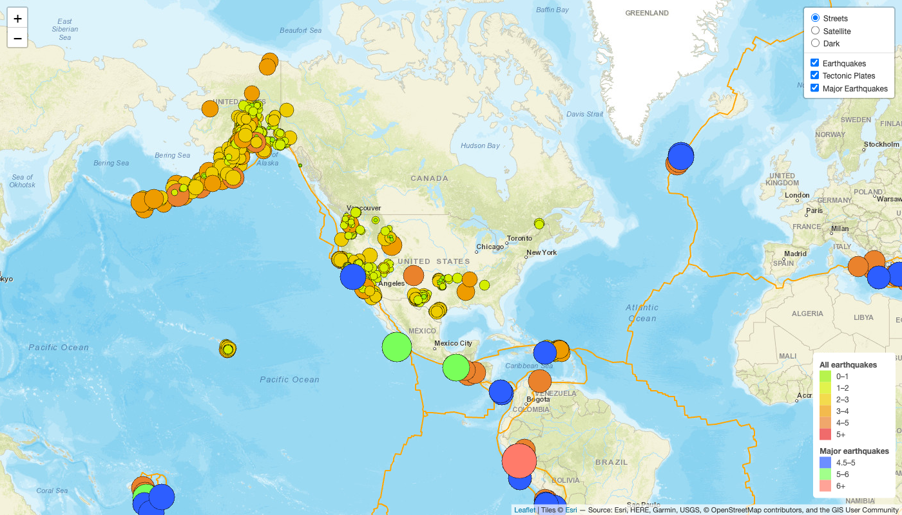

# Mapping Earthquakes

An interactive map of every earthquake recorded worldwide in the past 7 days, built with **JavaScript, Leaflet.js and D3**, using live GeoJSON data from the U.S. Geological Survey (USGS).

### 🌍 [View the live map](https://michaelxie1.github.io/Mapping_Earthquakes/Earthquake_Challenge/)



## What the map shows

- **Every earthquake from the past 7 days.** Each one is a circle sized and coloured by magnitude, from green (under 1) to red (5+).
- **Major earthquakes (magnitude 4.5+)** as a separate layer with its own colour scale.
- **Tectonic plate boundaries** (orange lines), which show how closely earthquakes follow the edges of the plates.
- **Three base maps** to switch between: streets, satellite and dark.
- **Popups** with each earthquake's magnitude and location.
- **A legend** for both colour scales, and checkboxes to turn each layer on or off.

The data comes straight from the USGS feeds every time the page loads, so the map is always current.

## Background

This project started in the Columbia University Data Analytics Boot Camp (Leaflet / Mapbox module). Since the course, I have:

- **Fixed the tectonic plates layer.** A bug in the data request meant it never loaded.
- **Fixed major earthquakes of exactly magnitude 5.0 having no colour**, along with other smaller issues such as slow console logging.
- **Published it as a live demo.** The original used Mapbox base maps, which require a private API key, so nobody else could run it. The final map now uses Esri's free base maps, which need no key.

The original boot-camp submission is preserved at the [`bootcamp-submission`](https://github.com/michaelxie1/Mapping_Earthquakes/tree/bootcamp-submission) tag.

## Project structure

The project was built step by step. The final map is in `Earthquake_Challenge/`, and each earlier lesson lives on its own branch:

| Branch | What it builds |
|---|---|
| [`Simple_Leaflet_Map`](https://github.com/michaelxie1/Mapping_Earthquakes/tree/Simple_Leaflet_Map) | A basic Leaflet map |
| [`Mapping_Single_Points`](https://github.com/michaelxie1/Mapping_Earthquakes/tree/Mapping_Single_Points) | A single circle marker (Los Angeles) |
| [`Mapping_Multiple_Points`](https://github.com/michaelxie1/Mapping_Earthquakes/tree/Mapping_Multiple_Points) | U.S. cities, sized by population, with popups |
| [`Mapping_Lines`](https://github.com/michaelxie1/Mapping_Earthquakes/tree/Mapping_Lines) | A flight path drawn as a line |
| [`Mapping_GeoJSON_Points`](https://github.com/michaelxie1/Mapping_Earthquakes/tree/Mapping_GeoJSON_Points) | Major world airports loaded from GeoJSON |
| [`Mapping_GeoJSON_Linestrings`](https://github.com/michaelxie1/Mapping_Earthquakes/tree/Mapping_GeoJSON_Linestrings) | Airline routes out of Toronto |
| [`Mapping_GeoJSON_Polygons`](https://github.com/michaelxie1/Mapping_Earthquakes/tree/Mapping_GeoJSON_Polygons) | Toronto neighbourhood boundaries |
| [`Earthquakes_past7days`](https://github.com/michaelxie1/Mapping_Earthquakes/tree/Earthquakes_past7days) | The earthquake map, built in 5 steps (`logicStep1–5.js`) |
| [`Earthquake_Challenge`](https://github.com/michaelxie1/Mapping_Earthquakes/tree/Earthquake_Challenge) | The final challenge, as originally submitted |

The JSON files in the root folder (`majorAirports.json`, `torontoRoutes.json`, `torontoNeighborhoods.json`) are loaded by the GeoJSON lesson branches.

## How to run it locally

The final map needs no setup or API key. Clone the repo and open `Earthquake_Challenge/index.html` in a browser, or serve the folder:

```bash
git clone https://github.com/michaelxie1/Mapping_Earthquakes.git
cd Mapping_Earthquakes
python3 -m http.server
# then open http://localhost:8000/Earthquake_Challenge/
```

The earlier lessons (`Simple_Map/`, `Earthquakes_past7days/` and the lesson branches) still use Mapbox as taught in the course. To run those, create a free [Mapbox](https://www.mapbox.com/) token and save it in that folder's `static/js/config.js`:

```js
const API_KEY = "your-mapbox-token";
```

`config.js` is listed in `.gitignore`, so the key is never committed.

## Data sources

- Earthquakes: [USGS Earthquake Hazards Program](https://earthquake.usgs.gov/earthquakes/feed/v1.0/geojson.php), past-7-days GeoJSON feeds
- Tectonic plates: [fraxen/tectonicplates](https://github.com/fraxen/tectonicplates) (Bird, 2003)
- Base maps: © Esri and its data partners, including OpenStreetMap contributors

## Tools

JavaScript, Leaflet.js, D3.js, GeoJSON, HTML/CSS
